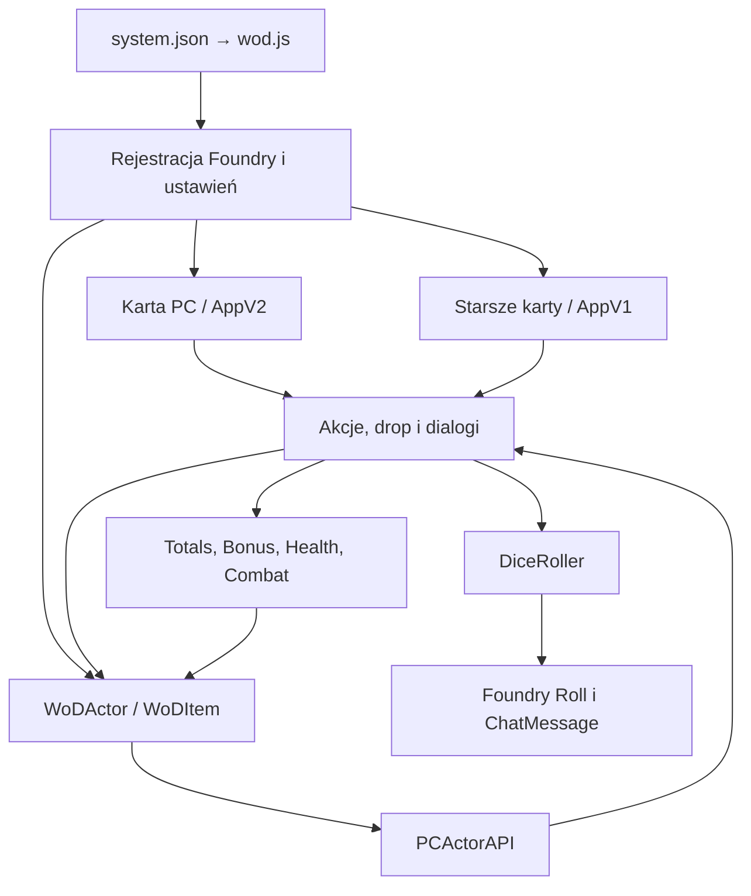
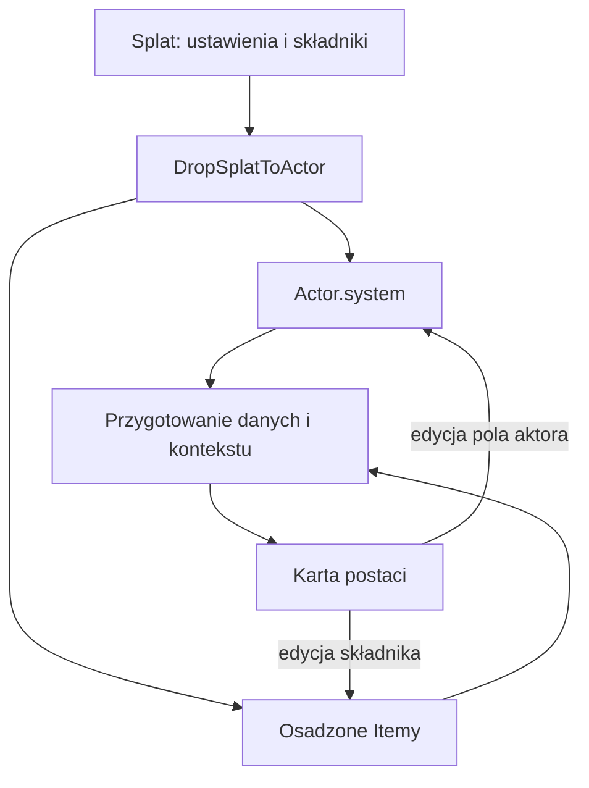

# WoD20 7.4.0 — mapa architektury v0.1

Status: pierwsza mapa oparta na analizie statycznej kodu. Data: 28 listopada 2026.
Cel: ustalanie miejsca zmiany, jej odbiorców i zakresu regresji między liniami gry.

## 1. Punkt odniesienia i zakres

| Pole | Wartość |
| --- | --- |
| Repozytorium źródłowe | JohanFalt/Foundry_WoD20 |
| Wydanie | [v7.4.0](https://github.com/JohanFalt/Foundry_WoD20/releases/tag/v7.4.0) |
| Commit analizowany | `32e360a6953d41685bc605ba2cc68e9998b2f9b8` |
| Drzewo tego commita | `e29d053ffb2ea82fb6f5a0e348d5cbf7f4d3053c` |
| Identyfikator systemu | `worldofdarkness` |
| Foundry w manifeście | minimum / verified / maximum: 14 / 14 / 14 |
| Publikacja wydania | 28 listopada 2026, 09:20:11 czasu polskiego |
| Zakres odczytu | pełny spis 688 plików; pobrane treści 125 plików, w tym wszystkich 105 plików JavaScript |
| Głębokość przeglądu | automatyczna ekstrakcja importów całości JS i ręczne prześledzenie głównych ścieżek; nie jest to przegląd każdej funkcji |
| Weryfikacja wykonania | brak potwierdzonego wyniku testów; środowisko odłączyło się przed uzyskaniem wyniku |
| Foundry na żywo | nie uruchamiano; brak odbioru zachowania w przeglądarce |

Opis dotyczy źródeł przypiętych do commita. Nie porównano bajtów archiwum instalacyjnego z tym drzewem. Wszystkie odsyłacze do kodu prowadzą do tego samego SHA. Osobna gałąź dokumentacyjna może otrzymywać kolejne commity bez zmiany punktu odniesienia opisywanego systemu.

Źródła bazowe: [system.json](https://github.com/JohanFalt/Foundry_WoD20/blob/32e360a6953d41685bc605ba2cc68e9998b2f9b8/system.json), [template.json](https://github.com/JohanFalt/Foundry_WoD20/blob/32e360a6953d41685bc605ba2cc68e9998b2f9b8/template.json), [wod.js](https://github.com/JohanFalt/Foundry_WoD20/blob/32e360a6953d41685bc605ba2cc68e9998b2f9b8/wod.js), [package.json](https://github.com/JohanFalt/Foundry_WoD20/blob/32e360a6953d41685bc605ba2cc68e9998b2f9b8/package.json).

## 2. Najważniejsza granica: PC i starsze typy aktorów

Wydanie utrzymuje dwie czynne architektury kart. Obie używają wspólnej klasy dokumentu `WoDActor` i części wspólnych pomocników.

| Wymiar | PC | Starsze typy, w tym Creature |
| --- | --- | --- |
| Typ dokumentu | `Actor.type === "PC"` | `Vampire`, `Werewolf`, `Mage`, `Wraith`, `Changeling` itd. |
| Karta | `PCActorSheet`, ActorSheetV2 + HandlebarsApplicationMixin | `MortalActorSheet` i klasy pochodne, AppV1 |
| Definicja danych | `PCDataModel` oraz modele osadzonych Itemów | szablony w `template.json` |
| Tożsamość postaci | ustawienia `splat`, `game`, `variant`, `variantsheet` oraz przedmioty | typ aktora oraz ustawienia i warianty |
| Umiejętności / przewagi | osadzone `Ability` / `Advantage`; także struktury przygotowywane na aktorze | głównie pola `actor.system` |
| Definiowanie postaci | upuszczenie przedmiotu `Splat` importuje ustawienia i składniki | ustawienia właściwego typu i wariantu |
| Publiczne API systemu | getter `actor.api` udostępnia `PCActorAPI` | getter zwraca `undefined` |
| Ruch | `CombatHelper.CalculateMovementv2` | `CombatHelper.CalculateMovement` |
| Szablony widoku | głównie wspólne części `.hbs` | głównie `.html` i części właściwe dla linii |

**Znaczenie dla zmian:** „obsługuje Wampira” nie określa jeszcze, czy zmiana działa dla PC z wampirzym szablonem, starszego aktora Vampire, czy obu. Tak samo należy traktować pozostałe linie.

Źródła: [wod.js:204](https://github.com/JohanFalt/Foundry_WoD20/blob/32e360a6953d41685bc605ba2cc68e9998b2f9b8/wod.js#L204), [module/actor/template/_module.js](https://github.com/JohanFalt/Foundry_WoD20/blob/32e360a6953d41685bc605ba2cc68e9998b2f9b8/module/actor/template/_module.js), [module/actor/data/wod-actor-base.js:15](https://github.com/JohanFalt/Foundry_WoD20/blob/32e360a6953d41685bc605ba2cc68e9998b2f9b8/module/actor/data/wod-actor-base.js#L15), [module/actor/template/pc-actor-sheet.js:44](https://github.com/JohanFalt/Foundry_WoD20/blob/32e360a6953d41685bc605ba2cc68e9998b2f9b8/module/actor/template/pc-actor-sheet.js#L44), [module/actor/template/mortal-actor-sheet.js:17](https://github.com/JohanFalt/Foundry_WoD20/blob/32e360a6953d41685bc605ba2cc68e9998b2f9b8/module/actor/template/mortal-actor-sheet.js#L17).

## 3. Mapa komponentów

Strzałki pokazują główne zależności i wywołania. To widok logiczny; nie jest pełnym grafem wszystkich importów.

`Calc → Docs` oznacza wykorzystanie wyników w przygotowaniu danych i zapisach wykonywanych przez wywołujących. Nie oznacza, że każdy kalkulator sam zapisuje dokument. API potrafi także bezpośrednio wywoływać silnik rzutu.

| Obszar | Odpowiedzialność | Główne pliki |
| --- | --- | --- |
| Uruchamianie | rejestracja dokumentów, modeli, kart, hooków, ustawień, danych i migracji | `wod.js` |
| Konfiguracja | słowniki typów i mechanik; ustawienia świata | `module/config.js`, `module/settings.js` |
| Dokument aktora | tworzenie, przygotowanie danych, obsługa aktualizacji, API | `module/actor/data/wod-actor-base.js` |
| Dokument przedmiotu | normalizacja tworzenia i aktualizacji, typ i era przedmiotu | `module/items/data/wod-item-base.js` |
| Modele danych | schematy PC oraz Ability, Advantage, Sphere, Splat i Realm | `module/actor/datamodel/`, `module/items/datamodel/` |
| Karty | prezentacja, kontekst, formularze i wiązanie akcji | `module/actor/template/`, `module/items/template/` |
| Akcje | obsługa kropek, pól, aktywacji, rzutów i operacji właściwych dla linii | `module/scripts/action-helpers.js` |
| Tworzenie i import | inicjalizacja, przyciski, upuszczanie Splat i składników | `create-helpers.js`, `drop-helpers.js` |
| Reguły wspólne | sumy atrybutów, premie, soak, zdrowie, ruch i inicjatywa | `totals.js`, `bonus-helpers.js`, `health.js`, `combat-helpers.js` |
| Rzuty | dialogi, budowa puli, wynik, wydawanie Willpower i karta czatu | `module/dialogs/`, `module/scripts/roll-dice.js` |
| Zawartość | kompendia, konfiguracje biografii i umiejętności, widoki, języki i style | `packs/`, `assets/data/sheet/`, `templates/`, `lang/`, `css/` |
| Migracje | aktualizacja aktorów, ich przedmiotów, przedmiotów świata i kompendiów świata | `module/migration.js` |
| Integracje | hooki renderowania i opcjonalny dostawca prędkości dragRuler | `module/hooks.js` |

Nazwy skrócone w tabeli reguł i tworzenia oznaczają pliki w `module/scripts/`. Logika reguł nie jest ograniczona do tej warstwy: warunki właściwe dla linii występują również w dokumentach, akcjach, dialogach i kartach.

## 4. Cykl uruchomienia

1. Manifest wskazuje `wod.js` jako moduł wejściowy oraz style, języki i kompendia.
2. Przy `init` system rejestruje ustawienia i buduje `CONFIG.worldofdarkness`, przypisuje klasy dokumentów, modele i karty, rejestruje hooki i helpery Handlebars oraz przygotowuje dane w `game.worldofdarkness`.
3. Hook `setup` istnieje, ale jego ciało nie zawiera dodatkowej logiki.
4. Przy `ready` system zbiera zainstalowane moce, rejestruje ikony form i wycieczki; dla GM sprawdza wersję świata i uruchamia `UpdateWorld` albo `updates`.
5. Karty i dialogi korzystają następnie z globalnego kontekstu Foundry, konfiguracji i dokumentów.

Źródła: [wod.js:70](https://github.com/JohanFalt/Foundry_WoD20/blob/32e360a6953d41685bc605ba2cc68e9998b2f9b8/wod.js#L70), [wod.js:458](https://github.com/JohanFalt/Foundry_WoD20/blob/32e360a6953d41685bc605ba2cc68e9998b2f9b8/wod.js#L458), [wod.js:465](https://github.com/JohanFalt/Foundry_WoD20/blob/32e360a6953d41685bc605ba2cc68e9998b2f9b8/wod.js#L465), [module/scripts/wodsetup.js:1](https://github.com/JohanFalt/Foundry_WoD20/blob/32e360a6953d41685bc605ba2cc68e9998b2f9b8/module/scripts/wodsetup.js#L1), [module/migration.js:10](https://github.com/JohanFalt/Foundry_WoD20/blob/32e360a6953d41685bc605ba2cc68e9998b2f9b8/module/migration.js#L10).

**Granica platformy:** system jest kodem ładowanym przez Foundry. `package.json` służy narzędziom developerskim i testom Node; nie definiuje osobnego serwera aplikacji WoD20. Trwałość, uprawnienia dokumentów, tokeny, sceny, walka i komunikaty korzystają z usług Foundry.

## 5. Mapa danych i zapisu

`Splat` pełni rolę definicji instalowanej na postaci. Obsługa dropu kopiuje dane, tworzy i aktualizuje osadzone dokumenty oraz zapisuje ustawienia aktora. Sam schemat Splat nie oznacza automatycznie bieżącego dziedziczenia wszystkich późniejszych zmian definicji przez istniejące postaci.

| Rodzaj danych | Główne miejsce w PC | Uwaga przy zmianie |
| --- | --- | --- |
| Atrybuty | `system.attributes` | rozróżniać wartość bazową, premię i `total` |
| Biografia | `system.bio`, w tym `splatfields` i `visibility` | zakres widoczności pola wynika też z roli oglądającego |
| Umiejętności | Item `Ability` | aktor przygotowuje też `system.abilities` z Itemów |
| Przewagi i zasoby | Item `Advantage` | istotne identyfikatory, np. `bloodpool`, `corpus`, oraz grupy |
| Sfery i Dziedziny | Item `Sphere` / `Realm` | posiadają własne modele i karty |
| Moce, rytuały i cechy | `Power`, `Rote`, `Trait`, `Feature` | typ dokumentu i jego podtyp nie są tym samym |
| Formy | Item `Trait` z `system.type === "wod.types.shapeform"` | aktywacja wpływa na premie, soak i token |
| Premie | Item `Bonus` oraz listy premii obsługiwane przez BonusHelper | aktywność i kategoria decydują o odbiorcach |
| Zdrowie | `system.health`, `system.traits.health`; Corpus jako Advantage | wspólna obsługa zawiera różne tory obrażeń |
| Wartości wynikowe | m.in. `attributes.*.total`, `soak`, `initiative`, `movement` | część jest przeliczana/przygotowywana; część jawnie zapisywana |

Źródła: [module/actor/datamodel/pc-actor-datamodel.js](https://github.com/JohanFalt/Foundry_WoD20/blob/32e360a6953d41685bc605ba2cc68e9998b2f9b8/module/actor/datamodel/pc-actor-datamodel.js), [module/items/datamodel/spalt-item-datamodel.js](https://github.com/JohanFalt/Foundry_WoD20/blob/32e360a6953d41685bc605ba2cc68e9998b2f9b8/module/items/datamodel/spalt-item-datamodel.js), [module/scripts/drop-helpers.js:549](https://github.com/JohanFalt/Foundry_WoD20/blob/32e360a6953d41685bc605ba2cc68e9998b2f9b8/module/scripts/drop-helpers.js#L549), [module/actor/data/wod-actor-base.js:183](https://github.com/JohanFalt/Foundry_WoD20/blob/32e360a6953d41685bc605ba2cc68e9998b2f9b8/module/actor/data/wod-actor-base.js#L183), [module/scripts/health.js:10](https://github.com/JohanFalt/Foundry_WoD20/blob/32e360a6953d41685bc605ba2cc68e9998b2f9b8/module/scripts/health.js#L10).

Plik modelu Splat rzeczywiście nazywa się `spalt-item-datamodel.js`; to nazwa w wydaniu.

**Istotny punkt kontroli:** zapisy i przeliczenia nie mają jednego wspólnego wejścia. Formularz PC rozdziela zapis Itemu i aktora, akcje mają własne wywołania zapisu, dokumenty obsługują aktualizacje, a augmentacja jawnie utrwala wybrane sumy. Przy zmianie trzeba śledzić konkretnego wywołującego. W `WoDActor._onUpdate` i `_onUpdateDescendantDocuments` obsługa przeliczeń pokazana dla starszych aktorów pomija PC.

Źródła: [module/actor/template/pc-actor-sheet.js:359](https://github.com/JohanFalt/Foundry_WoD20/blob/32e360a6953d41685bc605ba2cc68e9998b2f9b8/module/actor/template/pc-actor-sheet.js#L359), [module/scripts/action-helpers.js:937](https://github.com/JohanFalt/Foundry_WoD20/blob/32e360a6953d41685bc605ba2cc68e9998b2f9b8/module/scripts/action-helpers.js#L937), [module/actor/data/wod-actor-base.js:805](https://github.com/JohanFalt/Foundry_WoD20/blob/32e360a6953d41685bc605ba2cc68e9998b2f9b8/module/actor/data/wod-actor-base.js#L805), [module/actor/data/wod-actor-base.js:932](https://github.com/JohanFalt/Foundry_WoD20/blob/32e360a6953d41685bc605ba2cc68e9998b2f9b8/module/actor/data/wod-actor-base.js#L932), [module/scripts/attribute-augmentation-helpers.js:258](https://github.com/JohanFalt/Foundry_WoD20/blob/32e360a6953d41685bc605ba2cc68e9998b2f9b8/module/scripts/attribute-augmentation-helpers.js#L258).

## 6. Trzy prześledzone przepływy

### F01 — rzut z karty lub API

- Karta PC wiąże akcję `rollDice` z `RollDice`, który przekazuje dane do `ActionHelper.RollDialog`.
- Dispatcher wybiera dialog i rodzaj rzutu. Przykładem jest `DialogGeneralRoll`; inne ścieżki dotyczą broni, soak, mocy, Arete i szału.
- Dialog/pomocnik buduje `DiceRollContainer` i wywołuje `DiceRoller`.
- Silnik interpretuje trudność, jedynki, dziesiątki, specjalizacje, kary i ustawienia; może wydać tymczasową Willpower.
- Powstaje wynik `Roll`, szablon `roll-template.hbs` oraz `ChatMessage`.
- Alternatywne wejście `actor.api` udostępnia m.in. `rollAttribute`, `rollAbility`, `rollAdvantage`, `useCombatItem` i `usePower`; część metod otwiera wspólne dialogi.

Źródła: [module/scripts/action-helpers.js:57](https://github.com/JohanFalt/Foundry_WoD20/blob/32e360a6953d41685bc605ba2cc68e9998b2f9b8/module/scripts/action-helpers.js#L57), [module/scripts/action-helpers.js:2103](https://github.com/JohanFalt/Foundry_WoD20/blob/32e360a6953d41685bc605ba2cc68e9998b2f9b8/module/scripts/action-helpers.js#L2103), [module/dialogs/dialog-generalroll.js](https://github.com/JohanFalt/Foundry_WoD20/blob/32e360a6953d41685bc605ba2cc68e9998b2f9b8/module/dialogs/dialog-generalroll.js), [module/scripts/roll-dice.js:285](https://github.com/JohanFalt/Foundry_WoD20/blob/32e360a6953d41685bc605ba2cc68e9998b2f9b8/module/scripts/roll-dice.js#L285), [module/actor/api-handler.js](https://github.com/JohanFalt/Foundry_WoD20/blob/32e360a6953d41685bc605ba2cc68e9998b2f9b8/module/actor/api-handler.js).

Wniosek: zmiana rzutu może dotykać wspólnego silnika, ale także składania puli przed wejściem do niego. Udany test samego DiceRoller nie potwierdza poprawności wszystkich dialogów.

### F02 — instalacja szablonu PC

- Karta odbiera upuszczony Item i przekazuje obsługę do DropHelper.
- `DropSplatToActor` sprawdza istniejący Splat i wykonuje operacje na umiejętnościach, przewagach, formach i mocach.
- Z definicji importuje składniki, pola biografii, limity, zdrowie, soak, erę i identyfikatory szablonu.
- Zapisuje dokumenty osadzone i aktora; nie jest to pojedyncza operacja obejmująca cały zestaw danych.

Źródła: [module/actor/template/pc-actor-sheet.js:805](https://github.com/JohanFalt/Foundry_WoD20/blob/32e360a6953d41685bc605ba2cc68e9998b2f9b8/module/actor/template/pc-actor-sheet.js#L805), [module/scripts/drop-helpers.js:58](https://github.com/JohanFalt/Foundry_WoD20/blob/32e360a6953d41685bc605ba2cc68e9998b2f9b8/module/scripts/drop-helpers.js#L58), [module/scripts/drop-helpers.js:549](https://github.com/JohanFalt/Foundry_WoD20/blob/32e360a6953d41685bc605ba2cc68e9998b2f9b8/module/scripts/drop-helpers.js#L549).

Do sprawdzenia w Foundry: instalacja, wymiana i usunięcie szablonu oraz stan po przerwaniu którejś z operacji.

### F03 — Augment Attributes z 7.4.0

- Dostęp określa `augmentationAccess`: PC, właściciel, widoczny Advantage `bloodpool`, z wyjątkiem wariantu earthbound. Istniejące zarządzane premie mogą utrzymać dostęp do okna bez możliwości zwiększania.
- Popup wywołuje `AttributeAugmentationHelper`.
- Pomocnik zarządza trzema Itemami Bonus o stałych identyfikatorach, przelicza i zapisuje wybrane sumy.
- Hooki zmian aktora i Itemów odświeżają otwarte okno.
- Kolejka w module jest lokalna dla danego klienta. Nie stanowi blokady obejmującej wszystkie przeglądarki.

Źródła: [module/ui/attribute-augmentation-popup.js](https://github.com/JohanFalt/Foundry_WoD20/blob/32e360a6953d41685bc605ba2cc68e9998b2f9b8/module/ui/attribute-augmentation-popup.js), [module/scripts/attribute-augmentation-helpers.js:78](https://github.com/JohanFalt/Foundry_WoD20/blob/32e360a6953d41685bc605ba2cc68e9998b2f9b8/module/scripts/attribute-augmentation-helpers.js#L78), [module/scripts/attribute-augmentation-helpers.js:258](https://github.com/JohanFalt/Foundry_WoD20/blob/32e360a6953d41685bc605ba2cc68e9998b2f9b8/module/scripts/attribute-augmentation-helpers.js#L258), [module/scripts/attribute-augmentation-helpers.js:279](https://github.com/JohanFalt/Foundry_WoD20/blob/32e360a6953d41685bc605ba2cc68e9998b2f9b8/module/scripts/attribute-augmentation-helpers.js#L279).

Wniosek: kwalifikacja do funkcji opiera się na zasobie i wariancie, a nie wyłącznie na etykiecie Vampire. Mapa zmian powinna rozróżniać uprawnienie do akcji, jej zapis i odświeżenie odbiorców.

## 7. Linie gry — miejsca specjalizacji

Tabela potwierdza ślady implementacji w kodzie. Nie jest certyfikatem kompletności zasad ani spisem wszystkich szablonów dostępnych w kompendiach.

| Linia / rodzina | Wspólne punkty specjalizacji PC | Starsza karta / dodatkowy kod |
| --- | --- | --- |
| Wampir | Advantage bloodpool, generacja, moce i premie; augmentacja | `vampire-actor-sheet.js`, obliczenia w WoDActor |
| Wilkołak i Changing Breeds | Rage/Gnosis, Trait shapeform, premie i ikony form | `werewolf-actor-sheet.js`, `changingbreed-actor-sheet.js`, token-helpers |
| Mag | Sfery, Arete, Kwintesencja/Paradoks, rezonanse | `mage-actor-sheet.js`, `dialog-aretecasting.js` |
| Upiór | Advantage Corpus, osobny tor obrażeń, wariant shadow, passions/fetters | `wraith-actor-sheet.js`, `health.js` |
| Podrzutek | Realms, chimerical health/soak, specjalizacja widoku i akcji | `changeling-actor-sheet.js`, `select/changeling.js` |
| Łowca | Conviction, cnoty i moce/Edges | `hunter-actor-sheet.js`, `select/hunter.js` |
| Demon | Faith/Torment, formy apokaliptyczne, rzuty Lore | `demon-actor-sheet.js`, `select/demon.js`, roll-dice |
| Mumia | ustawienia/zasoby właściwe dla szablonu; ślady obliczeń Balance | `mummy-actor-sheet.js`, WoDActor i CreateHelper |
| Exalted | Charms, aspekty i formy w zawartości; ustawienia wariantu | `exalted-actor-sheet.js`, WoDActor i CreateHelper |
| Śmiertelnik i warianty | wspólna karta i szablony; obsługa m.in. Sorcerer/Orpheus | `mortal-actor-sheet.js`, CreateHelper |
| Creature / duchy | warianty i zasoby; odrębności pul i ruchu | `creature-actor-sheet.js`, WoDActor, dialog broni |

Nie należy sprowadzać wyboru mechaniki do jednego pola `splat`. Kod odczytuje również `game`, `variant`, `variantsheet`, obecność Itemów i flagi `has*`. W następnej iteracji trzeba spisać te warunki osobno dla każdej funkcji wspólnej.

Punkty dowodowe: [module/actor/data/wod-actor-base.js:46](https://github.com/JohanFalt/Foundry_WoD20/blob/32e360a6953d41685bc605ba2cc68e9998b2f9b8/module/actor/data/wod-actor-base.js#L46), [module/actor/template/pc-actor-sheet.js:995](https://github.com/JohanFalt/Foundry_WoD20/blob/32e360a6953d41685bc605ba2cc68e9998b2f9b8/module/actor/template/pc-actor-sheet.js#L995), [module/actor/template/pc-actor-sheet.js:1096](https://github.com/JohanFalt/Foundry_WoD20/blob/32e360a6953d41685bc605ba2cc68e9998b2f9b8/module/actor/template/pc-actor-sheet.js#L1096), [module/scripts/create-helpers.js:1820](https://github.com/JohanFalt/Foundry_WoD20/blob/32e360a6953d41685bc605ba2cc68e9998b2f9b8/module/scripts/create-helpers.js#L1820), [module/config.js](https://github.com/JohanFalt/Foundry_WoD20/blob/32e360a6953d41685bc605ba2cc68e9998b2f9b8/module/config.js).

## 8. Zależności statyczne i obszary dużego wpływu

Inwentaryzacja: 105 plików JS (98 w `module/`), 196 szablonów (74 HBS i 122 HTML), 13 typów Actor, 16 typów Item, 32 kompendia, 17 arkuszy stylów z manifestu, 7 języków, 12 plików testowych.

Metoda grafu: ekstrakcja literalnych względnych importów i reeksportów z treści JS, usunięcie komentarzy blokowych, normalizacja ścieżek i deduplikacja par plików. Wynik: **245 krawędzi**, brak celu importu nieobecnego w drzewie źródłowym. To analiza tekstowa, nie pełny parser ani graf wywołań.

| Plik | Liczba innych plików importujących lub reeksportujących |
| --- | ---: |
| `module/scripts/bonus-helpers.js` | 22 |
| `module/scripts/action-helpers.js` | 17 |
| `module/scripts/create-helpers.js` | 15 |
| `module/scripts/roll-dice.js` | 13 |
| `module/actor/template/mortal-actor-sheet.js` | 12 |
| `module/scripts/combat-helpers.js` | 11 |
| `module/scripts/select-helpers.js` | 10 |
| `module/scripts/totals.js` | 7 |
| `module/scripts/drop-helpers.js` | 7 |
| `module/scripts/select/utils.js` | 6 |

Duża liczba zależności wskazuje szeroki potencjalny zakres regresji; sama nie dowodzi błędu ani potrzeby refaktoryzacji.

Wykryto cykl `combat-helpers.js ↔ roll-dice.js`. Ten sam cykl jest jawnie dopuszczony w istniejącym `tests/release.test.mjs`. Ocena „dopuszczony” odnosi się do intencji testów; w tej sesji nie potwierdzono wykonania testów.

Od `wod.js` graf statycznych importów/reeksportów osiąga 103 ze 105 plików JS. Pozostałe to `module/dialogs/dialog-weapon.js` i `module/scripts/import-helpers.js`. Nie stwierdzam na tej podstawie, że są bezpieczne do usunięcia: graf nie obejmuje odwołań zewnętrznych, makr i dynamicznych wywołań. Aktywna ścieżka dialogu broni wymaga uwzględnienia `dialog-weaponv2.js`.

Pełny graf, metadane plików i metoda są w [inventory.json](inventory.json).

## 9. Weryfikacja i ograniczenia

**Potwierdzone w tej sesji:**

- tag v7.4.0 wskazuje wskazany wyżej commit; manifest i package deklarują 7.4.0;
- spis drzewa jest kompletny (`truncated: false`);
- pobrano treści wszystkich plików JS i zbudowano graf względnych importów;
- ręcznie prześledzono rejestrację, rozdział PC/legacy, główne miejsca zapisu, rzut, instalację Splat i augmentację;
- potwierdzono definicje istniejących testów i ich deklarowany zakres.

**Niepotwierdzone:**

- wynik testów jednostkowych i pełnego `npm test`; próba uruchomienia zakończyła się utratą środowiska, bez wyniku;
- wykonanie i renderowanie Mermaid w przeglądarce;
- zachowanie kart i dialogów w Foundry V14;
- pełna zawartość binarnych baz kompendiów, kompletność szablonów i relacje UUID;
- pełny graf include/partial szablonów, wywołań, odczytów i zapisów;
- rzeczywista synchronizacja dwóch klientów, aktorzy tokenowi i zachowanie po migracji świata.

Istniejące testy obejmują m.in. sumy, premie, zdrowie, ruch, rzuty, wersjonowanie migracji, augmentację, widoczność biografii, pule broni duchów oraz statyczne kontrole wydania. Uruchamiają się w Node z atrapami Foundry, więc nawet wynik PASS nie zastępuje odbioru UI.

Źródła: [tests/README.md](https://github.com/JohanFalt/Foundry_WoD20/blob/32e360a6953d41685bc605ba2cc68e9998b2f9b8/tests/README.md), [tests/release.test.mjs](https://github.com/JohanFalt/Foundry_WoD20/blob/32e360a6953d41685bc605ba2cc68e9998b2f9b8/tests/release.test.mjs), [package.json](https://github.com/JohanFalt/Foundry_WoD20/blob/32e360a6953d41685bc605ba2cc68e9998b2f9b8/package.json).

## 10. Kolejka dalszych prac

| ID | Zadanie | Warunek zakończenia | Stan |
| --- | --- | --- | --- |
| A01 | zamrożenie wersji i inwentaryzacja | SHA, manifest, pełne drzewo, graf importów | wykonane |
| A02 | mapa komponentów i podstawowych przepływów | mapa PC/legacy, zapis, rzut, Splat i augmentacja z odsyłaczami | pierwsza wersja wykonana |
| A03 | mapa pól oraz odczytów i zapisów | dla attributes, advantages, health, soak, initiative, movement: źródło, autor zapisu, odbiorcy i odświeżanie | następne |
| A04 | katalog specjalizacji między liniami | macierz `typ × szablon × wariant × zasób` z odsyłaczami do warunków | otwarte |
| A05 | mapa szablonów i kompendiów | include/partial, dostępne Splats i odwołania UUID | otwarte |
| A06 | weryfikacja wykonania | istniejące testy oraz scenariusze Foundry dla PC, starszej karty i aktora tokenowego | oczekuje na środowisko |
| A07 | zastosowanie do zgłoszeń v8.x | powiązanie zgłoszeń z komponentami i wspólnymi odbiorcami zmiany | po A03–A04 |

Najbliższy konkretny wycinek A03: **atrybut → Bonus → total → pula rzutu / soak / inicjatywa / ruch → odświeżenie karty**. Pokazuje realny zasięg wspólnej poprawki, a zarazem pozwala porównać PC ze starszymi modelami.

Zasada utrzymania mapy: każda zależność istotna dla decyzji ma wskazanie źródła; wnioski ze statyki są oddzielone od wyników wykonania. Zmiana wersji systemu wymaga jawnego nowego SHA i aktualizacji inwentaryzacji.
