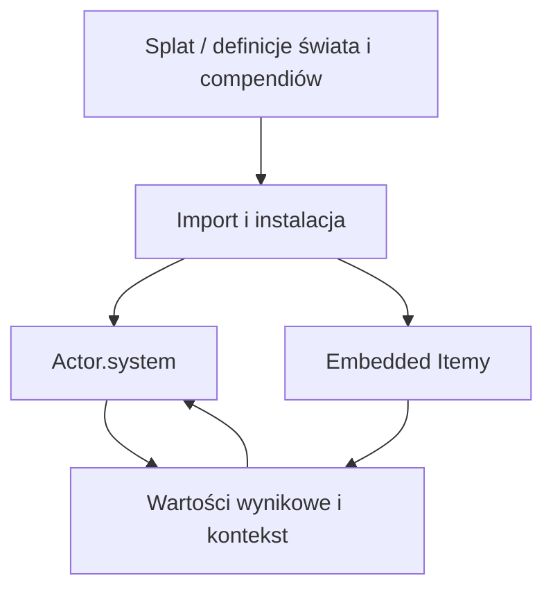

# D02 — Domain Model, Data Dictionary i Source of Truth
Baseline `32e360a6953d41685bc605ba2cc68e9998b2f9b8`. Rozdział opisuje As-Is. Pełny słownik definicji sześciu modeli jest w [catalog.json](catalog.json). Ekstrakcja uruchamia defineSchema z atrapami opisującymi pola: potwierdza deklaracje, nie walidację Foundry ani utrwalanie dokumentów.

## Model domeny
Actor ma system i kolekcję osadzonych Itemów. Item świata lub z compendium jest źródłem importu; osadzona kopia jest dokumentem postaci. Item typu Splat zawiera definicje i odwołania UUID składników. Foundry dostarcza Actor, Item, TokenDocument, Combatant, Roll i ChatMessage. Mapa nie zakłada automatycznej synchronizacji kopii ze źródłem w compendium.

Ostatnia strzałka oznacza jawne zapisy wykonywane przez część wywołujących; przygotowanie kontekstu samo w sobie nie jest trwałym zapisem. Dowody: [module/scripts/drop-helpers.js:549](https://github.com/JohanFalt/Foundry_WoD20/blob/32e360a6953d41685bc605ba2cc68e9998b2f9b8/module/scripts/drop-helpers.js#L549), [module/actor/data/wod-actor-base.js:183](https://github.com/JohanFalt/Foundry_WoD20/blob/32e360a6953d41685bc605ba2cc68e9998b2f9b8/module/actor/data/wod-actor-base.js#L183).

## Słownik semantyczny i źródła prawdy
| ID | Dane | Źródło / charakter | Autor zmiany i odbiorca |
| --- | --- | --- | --- |
| DAT-001 | attributes.*.value | bazowa wartość aktora, trwała | formularz/kropki, instalacja/migracja → totals |
| DAT-002 | attributes.*.max | dopuszczony limit pola; niezależny od total | model, Splat, normalizacja → widok/edycja |
| DAT-003 | attributes.*.bonus | bezpośrednia premia pola aktora | edycja/normalizacja → totals |
| DAT-004 | attributes.*.total | wynik bazowej wartości i premii, z wyjątkami/formą/pancerzem | totals oraz wywołujący zapis → rzuty, soak, inicjatywa, ruch |
| DAT-005 | Ability.system.value/max/speciality | osadzony Item w PC | Item.update → przygotowany system.abilities i karta/pula |
| DAT-006 | Advantage.permanent/temporary | znaczenie zależne od przewagi i settings | kropki, reguły, spending → karta i roll |
| DAT-007 | Advantage.max / perturn | pojemność/limit; nie stan bieżący | model, generacja/ustawienia → ograniczenia/widok |
| DAT-008 | Advantage.roll | wartość do rzutu; wynik ustawień permanent/temporary/usebothrolls | obliczenia Item/Actor → dialog i API |
| DAT-009 | Bonus.system.value/type/settingtype/isactive | samodzielny dokument premii | akcja, popup, edycja → BonusHelper |
| DAT-010 | Item.system.bonuslist | wpisy premii osadzone w przedmiocie; nie osobne embedded dokumenty Foundry | drop/edycja/aktywacja → BonusHelper i konsumenci |
| DAT-011 | health.damage.* | liczniki obrażeń zwykłych/chimerical/corpus | akcje zdrowia i API → obliczenia toru i kary |
| DAT-012 | health.<level>.value/total/penalty | bazowa liczba pól, wynik z premią, kara poziomu | Splat/edycja/totals → tor zdrowia i pule |
| DAT-013 | traits.health.totalhealthlevels | dodatkowa reprezentacja sumy/paska | normalizacja i Splat → token/UI; helper zdrowia potrafi sumować poziomy zamiast ufać max |
| DAT-014 | soak.* / soak.chimerical.* | wynik Stamina, premii, pancerza i flag rollable | totals → dialog soak; flaga formy może zmienić dopuszczony tor |
| DAT-015 | initiative.base/bonus/total | baza, bezpośredni bonus i wynik | totals → InitiativeRoll/Combatant |
| DAT-016 | movement | PC: obiekty value/isactive; legacy: wartości liczbowe | CalculateMovementv2/CalculateMovement → karta i integracje |
| DAT-017 | settings.game/era/splat/variant/variantsheet | trwałe ustawienia o różnych rolach | instalacja/reset/edycja → selektory, reguły i prezentacja |
| DAT-018 | flags.worldofdarkness.attributeAugmentation | marker właściciela trzech zarządzanych premii | helper augmentacji → wykrycie konfliktów i aktualizacja |
| DAT-019 | bio.visibility | konfiguracja widoczności pól per rola | właściciel/settings → kontekst i Handlebars |
| DAT-020 | TokenDocument / Combatant | dokumenty platformy i powiązanie ze sceną/walką | aktywacja form i inicjatywa → token/combat; szczegóły unlinked: GAP-004 |

Dowody: [module/actor/datamodel/pc-actor-datamodel.js](https://github.com/JohanFalt/Foundry_WoD20/blob/32e360a6953d41685bc605ba2cc68e9998b2f9b8/module/actor/datamodel/pc-actor-datamodel.js), [module/actor/datamodel/base/actor_attributes.js](https://github.com/JohanFalt/Foundry_WoD20/blob/32e360a6953d41685bc605ba2cc68e9998b2f9b8/module/actor/datamodel/base/actor_attributes.js), [module/items/datamodel/advantage-item-datamodel.js](https://github.com/JohanFalt/Foundry_WoD20/blob/32e360a6953d41685bc605ba2cc68e9998b2f9b8/module/items/datamodel/advantage-item-datamodel.js), [module/items/data/wod-item-base.js:221](https://github.com/JohanFalt/Foundry_WoD20/blob/32e360a6953d41685bc605ba2cc68e9998b2f9b8/module/items/data/wod-item-base.js#L221), [module/scripts/bonus-helpers.js](https://github.com/JohanFalt/Foundry_WoD20/blob/32e360a6953d41685bc605ba2cc68e9998b2f9b8/module/scripts/bonus-helpers.js), [module/scripts/combat-helpers.js](https://github.com/JohanFalt/Foundry_WoD20/blob/32e360a6953d41685bc605ba2cc68e9998b2f9b8/module/scripts/combat-helpers.js), [module/scripts/health.js](https://github.com/JohanFalt/Foundry_WoD20/blob/32e360a6953d41685bc605ba2cc68e9998b2f9b8/module/scripts/health.js), [module/scripts/attribute-augmentation-helpers.js](https://github.com/JohanFalt/Foundry_WoD20/blob/32e360a6953d41685bc605ba2cc68e9998b2f9b8/module/scripts/attribute-augmentation-helpers.js).

**Nie istnieje jedno uniwersalne znaczenie permanent/temporary/max dla wszystkich zasobów.** Model określa wspólne pola i flagi, lecz reguły zależą od id/grupy, linii i ustawień. #973 wskazuje dodatkowo różnicę między liczbą punktów krwi a tym, do jakich celów wolno je wydać; nie wolno sprowadzać tego do jednego ograniczenia max.

## Atrybut → premia → wynik → odbiorcy
1. Totals rozpoczyna od value + bonus oraz korekt form starszych typów.
2. attribute_buff zwiększa wartość wynikową; attribute_fixed_value nadpisuje ją w dalszej części tej sekcji. Później kod stosuje m.in. kary pancerza do Dexterity, więc „fixed” nie oznacza ostatniej operacji całego calculateTotals.
3. Dialog standardowego rzutu odczytuje total. attribute_dice_buff dodaje kości osobno, bez konieczności podnoszenia total. attribute_diff zmienia trudność, a attribute_auto_buff jest odczytywany przez silnik sukcesów.
4. Stamina.total trafia do dopuszczonych torów soak. Dexterity.total i Wits.total do standardowej inicjatywy. Dla spirit istnieje odrębna ścieżka.
5. Dexterity.total wpływa na jog=DEX+12 i run=3×DEX+20 przed korektami form i mnożnikami ruchu. Zmiana Dexterity o +2 może zatem zmienić bazowy jog o +2 i run o +6; przy formach/mnożnikach wynik końcowy może być inny.
6. Ruch jest liczony w prepareDerivedData; augmentacja zapisuje sumy atrybutów/soak/zdrowia/inicjatywy, a nie cały ruch. Kolejność i odświeżanie wszystkich części wymagają runtime.

Dowody: [module/scripts/totals.js:3](https://github.com/JohanFalt/Foundry_WoD20/blob/32e360a6953d41685bc605ba2cc68e9998b2f9b8/module/scripts/totals.js#L3), [module/dialogs/dialog-generalroll.js:287](https://github.com/JohanFalt/Foundry_WoD20/blob/32e360a6953d41685bc605ba2cc68e9998b2f9b8/module/dialogs/dialog-generalroll.js#L287), [module/scripts/roll-dice.js:285](https://github.com/JohanFalt/Foundry_WoD20/blob/32e360a6953d41685bc605ba2cc68e9998b2f9b8/module/scripts/roll-dice.js#L285), [module/scripts/combat-helpers.js:89](https://github.com/JohanFalt/Foundry_WoD20/blob/32e360a6953d41685bc605ba2cc68e9998b2f9b8/module/scripts/combat-helpers.js#L89), [module/scripts/attribute-augmentation-helpers.js:236](https://github.com/JohanFalt/Foundry_WoD20/blob/32e360a6953d41685bc605ba2cc68e9998b2f9b8/module/scripts/attribute-augmentation-helpers.js#L236).

## Macierz zapisu
| Wejście | Zapis źródłowy | Przeliczenie / dalszy skutek |
| --- | --- | --- |
| PC.onSubmitActorForm, cel z itemid | Item.update | ten branch wraca po zapisie; nie zakładać wspólnej transakcji aktora |
| PC.onSubmitActorForm, pole aktora | Actor.update | tylko część wejść ustawia runtotals; następnie _setItems |
| OnDotCounterChange, pole aktora | Actor.update | calculateTotals przed zapisem |
| OnDotCounterChange, pole Itemu | Item.update | osobna logika ograniczania permanent/temporary |
| Aktywacja Itemu/bonusu | Item.update i/lub Actor.update w handlerze | ścieżkę ustalić dla konkretnego typu |
| AugmentationHelper | create/updateEmbeddedDocuments Item | persistTotals zapisuje wybrane zmienione pola; kontroluje wynik i konflikty |
| WoDActor._onUpdate / descendant | wtórne Actor.update dla legacy | PC jest wyłączony z tych konkretnych gałęzi |
| DropSplatToActor | wiele operacji Item + Actor.update | brak jednej transakcji obejmującej wszystko |
| RemoveSplatFromActor | delete wszystkich Itemów + Actor.update | reset nie zapewnia historii stanu sprzed zmiany |

Dowody: [module/actor/template/pc-actor-sheet.js:359](https://github.com/JohanFalt/Foundry_WoD20/blob/32e360a6953d41685bc605ba2cc68e9998b2f9b8/module/actor/template/pc-actor-sheet.js#L359), [module/scripts/action-helpers.js:937](https://github.com/JohanFalt/Foundry_WoD20/blob/32e360a6953d41685bc605ba2cc68e9998b2f9b8/module/scripts/action-helpers.js#L937), [module/actor/data/wod-actor-base.js:805](https://github.com/JohanFalt/Foundry_WoD20/blob/32e360a6953d41685bc605ba2cc68e9998b2f9b8/module/actor/data/wod-actor-base.js#L805), [module/scripts/drop-helpers.js:837](https://github.com/JohanFalt/Foundry_WoD20/blob/32e360a6953d41685bc605ba2cc68e9998b2f9b8/module/scripts/drop-helpers.js#L837).

## Lifecycle i redundancja
Instalacja kopiuje definicję → przygotowanie normalizuje dane → akcje i formularze zapisują → kalkulatory/kontekst odczytują → migracje aktualizują strukturę. system.abilities i system.advantages PC są przygotowywane z Itemów; nie należy traktować ich bezrefleksyjnie jako niezależnego miejsca edycji. isupdated jest używaną flagą przepływu, nie wersją transakcji.
Efekty w zakładce Effects obejmują systemowe Itemy Bonus i ich listy. Nie utożsamiać całego mechanizmu z Foundry ActiveEffect; status form na tokenie jest dodatkową ścieżką.

Luki: kompletne read/write wszystkich pól, globalny wybór aktora w przypadku tokenowego Actor, semantyka transportu danych i ponowne przeliczanie po migracji — [rejestr](gaps-risks-decisions.md).
