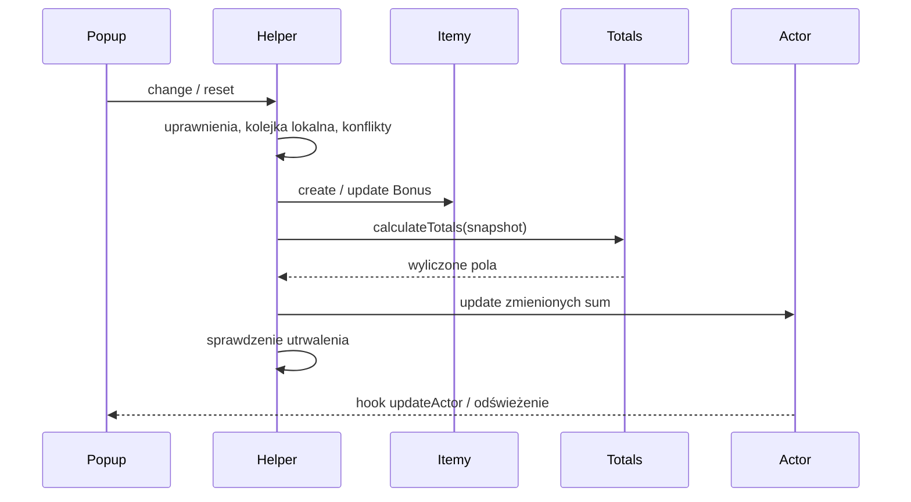

# D04 — katalog przepływów wykonania
Dla każdego scenariusza discovery.json zapisuje Trigger, Preconditions, Execution Path, Reads, Writes, Derived Calculations, Hooks, Side Effects, UI Refresh, Error Handling, Concurrency Risks i Cross-Splat Differences. Tam, gdzie kolejności lub zachowania nie odtworzono, pole mówi to jawnie. VERIFIED trasy kodu nie oznacza pełnego prześledzenia wszystkich branchy ani PASS(runtime).

## Katalog
| ID | Scenariusz | Trasa | Ważne rozróżnienie / stan |
| --- | --- | --- | --- |
| SCN-001 Utworzenie postaci | Foundry create Actor | WoDActor._preCreate → CreateHelper → przygotowanie dokumentu | PC i każdy starszy typ osobno; runtime NOT TESTED |
| SCN-002 Zastosowanie Splat | upuszczenie Item Splat | PC._onDropItem → OnDropItem → DropSplatToActor | Splat z formami, Corpus, chimerical i custom; PROBE-001; runtime NOT TESTED |
| SCN-003 Zmiana cechy | formularz albo klik kropki | form.handler / OnDotCounterChange → Item.update albo totals + Actor.update | nie mylić wartości bazowej, max, total i zasobu; runtime NOT TESTED |
| SCN-004 Dodanie/aktywacja bonusu | drop/edycja/aktywacja Item | BonusHelper.applyDroppedBonus / OnItemActive → kalkulatory | samodzielna premia i wpis w broni/armor; brak capability; runtime NOT TESTED |
| SCN-005 Dezaktywacja bonusu | wyłączenie aktywności | handler aktywności → Item.update → ponowne wykorzystanie kalkulatorów | odróżnić wyłączenie wpisu od odłożenia sprzętu; runtime NOT TESTED |
| SCN-006 Augment Attributes | klik ikony i +/−/reset | popup → helper kolejka lokalna → Itemy → persistTotals | także inne PC z capability; brak automatycznego kosztu krwi; runtime NOT TESTED |
| SCN-007 Zmiana formy | formActive | OnFormActivate → aktualizacja form i tokena → Actor | inne reguły Garou, Fera, custom forms; runtime NOT TESTED |
| SCN-008 Wydanie zasobu | Use Willpower w rzucie / klik zasobu | DiceRoller → _spendTemporaryWillpower; inne zasoby mają odrębne akcje | brak uogólnienia spending WP na Blood Pool/Rage/Pathos; runtime NOT TESTED |
| SCN-009 Standardowy rzut | rollDice lub actor.api | RollDialog → DialogGeneralRoll / API → DiceRoller → ChatMessage | PC/legacy, advantage, spirit, actorless; runtime NOT TESTED |
| SCN-010 Rzut na moc | usePower / przycisk mocy/czaru | dialog-power lub aretecasting → DiceRoller | Dyscypliny, Dary, Lore, Arete nie są identyczne; runtime NOT TESTED |
| SCN-011 Inicjatywa | macro/action RollInitiative | CombatHelper.RollInitiative → InitiativeRoll → combat/chat | spirit: inna baza; wiele tokenów i actor-only combatant; runtime NOT TESTED |
| SCN-012 Atak | użycie broni | DialogWeaponv2 → attack → opcjonalne damage | natural/melee/ranged oraz Rage/Willpower ducha; runtime NOT TESTED |
| SCN-013 Obrażenia | następny etap po ataku lub rzut damage | DialogWeaponv2 damage → DiceRoller | melee/natural vs ranged; #1173/#843 oddzielne wymagania; runtime NOT TESTED |
| SCN-014 Soak | dialog soak | DialogSoak → DiceRoller → karta wyniku | zwykły/chimerical, armor, forma i spirit; runtime NOT TESTED |
| SCN-015 Aktualizacja zdrowia | klik pola zdrowia albo API.modifyHealth | OnSquareCounterChange / API.modifyHealth → Actor | Corpus bez standardowej kary; chimerical osobno; runtime NOT TESTED |
| SCN-016 Obliczenie ruchu | Actor.prepareDerivedData | CalculateMovement lub CalculateMovementv2 | liczby legacy vs obiekty PC; mnożniki i formy; runtime NOT TESTED |
| SCN-017 Odświeżenie karty | zmiana dokumentu / render | Foundry callbacks → prepare*Context / getData → render i hooki | AppV1/AppV2; zamknięty popup; aktywna zakładka Combat; runtime NOT TESTED |
| SCN-018 Aktualizacja między klientami | zapis w kliencie A | zapis dokumentu Foundry → odbiór w B → hooki/render | dwie karty tego samego GM oraz owner+GM; wyścig +1; runtime NOT TESTED |
| SCN-019 Ograniczony czytelnik | otwarcie Actor przez Limited/Observer | przygotowanie kontekstu + helper widoczności → template | owner/GM nie jest tożsamy z Observer/Limited; brak dowodu redakcji danych; runtime NOT TESTED |
| SCN-020 Migracja wersji | ready z inną worldVersion | UpdateWorld → Actor/Items/world Items/world packs → updates | historyczny PC/legacy, brakujące dane, częściowa awaria; runtime NOT TESTED |
| SCN-021 Reset postaci przez usunięcie Splat | settings.removeSplat | OnRemoveSplat → RemoveSplatFromActor → render | nie jest przemianą preserving; wymaga testu niezamierzonej utraty danych; runtime NOT TESTED |

## SCN-006 — augmentacja: zapis źródła i wyników

To schemat głównych punktów, nie lista wszystkich odczytów. Helper także sprawdza Itemy i konflikt po zmianach. Zapis premii może się udać, a zapis sum nie; itemsApplied rozróżnia stan pewny/niepewny. Żądanie względne +1 nie powinno być ponawiane bez ponownego odczytu po niepewnym wyniku. Lokalna kolejka nie szereguje dwóch klientów.

Źródło: [attribute-augmentation-helpers.js](https://github.com/JohanFalt/Foundry_WoD20/blob/32e360a6953d41685bc605ba2cc68e9998b2f9b8/module/scripts/attribute-augmentation-helpers.js), [popup](https://github.com/JohanFalt/Foundry_WoD20/blob/32e360a6953d41685bc605ba2cc68e9998b2f9b8/module/ui/attribute-augmentation-popup.js). Istniejące testy helpera/popupu: PASS w Node. Dwa realne klienty i zakładka Combat: BLOCKED w tej sesji.

## SCN-002 — instalacja i wymiana Splat
Import umiejętności, przewag, form i mocy zapisuje Itemy osobno, potem ustawienia aktora. W gałęzi z już istniejącym Itemem Splat i zgodą na zastąpienie odwołanie do idsToDelete poprzedza deklarację let. PROBE-001 odtwarza ReferenceError przed delete; to konkretny brak aktualnej ścieżki, niezależny od projektowania przemiany #941.
Nie przenosić wyniku tej próby na czysty PC bez Splat ani na pełny interfejs Foundry.

## SCN-021 — reset a przemiana
OnRemoveSplat wymaga odblokowanej karty i potwierdzenia. RemoveSplatFromActor pobiera ID wszystkich Itemów, usuwa je i resetuje duży zakres danych. Nie ma w tej funkcji rozróżnienia „cecha z szablonu” kontra „własny ekwipunek”. To istniejący reset. Wymaganie zachowania tożsamości i dorobku w #941 ma odmienną semantykę.

## SCN-009 / SCN-008 — wynik rzutu może zmienić zasób
Dialog buduje pulę, a DiceRoller może przed rzutem wydać temporary Willpower. PC zapisuje Advantage Item, legacy zapisuje actor.system.advantages.willpower.temporary. Reroll #1481 musi zatem określić, czy powtarza koszt, odtwarza poprzedni stan, czy ponownie ocenia obecną postać.

## Dalszy odbiór
Priorytet: SCN-002/021 (instalacja, wymiana, reset), SCN-003/006/016/017 (atrybut→odbiorcy→refresh), SCN-018 (dwa klienty), SCN-019 (role). Pozostałe scenariusze mają wyznaczone trasy i wejścia; nie oznaczono ich jako wykonane tylko na tej podstawie.
